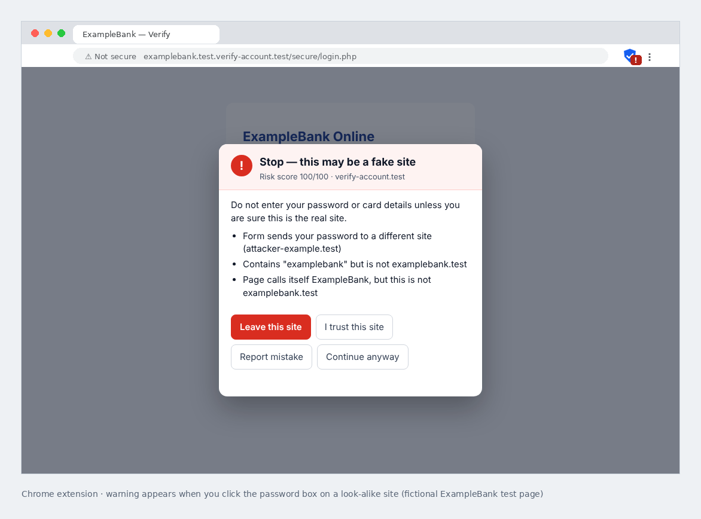
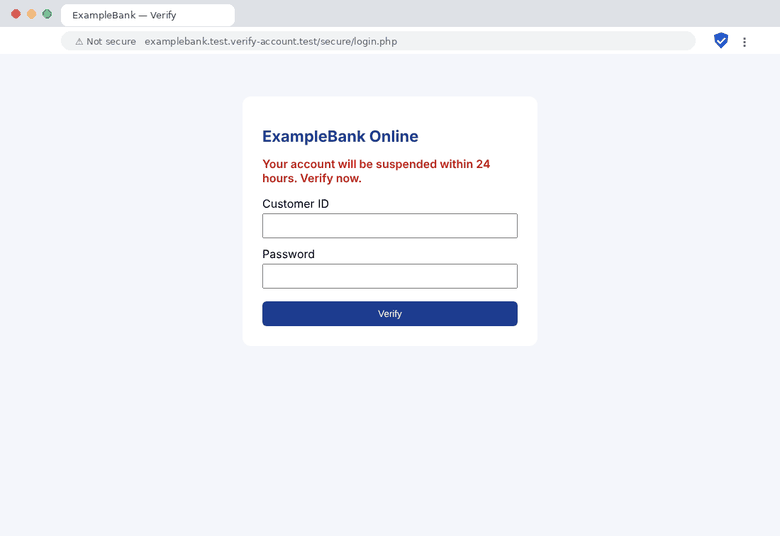
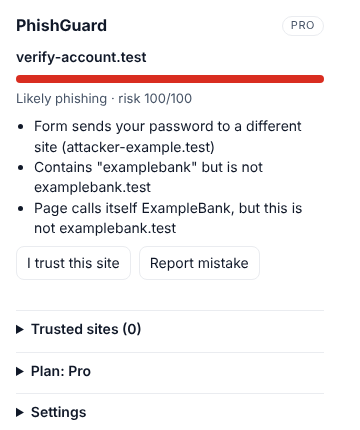
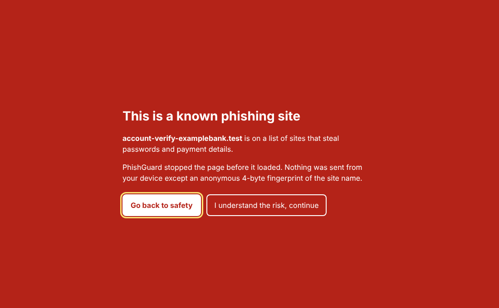
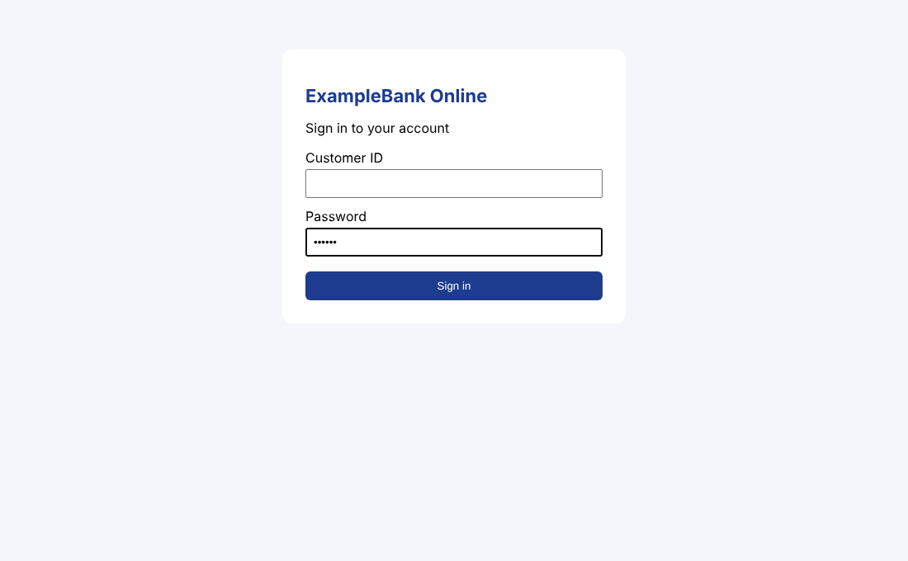
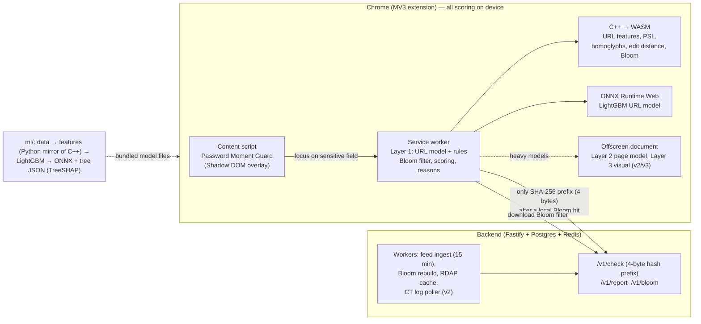

# PhishGuard AI — Chrome Extension

[](https://github.com/sandeepraj25/PhishGuard-AI/actions/workflows/ci.yml)


> 🛡️ **A Chrome extension (Manifest V3)** that warns you at the exact moment you type a password or card number on a phishing site, explains why in plain language, and aims to catch brand-new phishing domains before public blocklists do. All checks run inside your browser.



### Install in Chrome (developer mode)

```bash
git clone https://github.com/sandeepraj25/PhishGuard-AI.git
cd PhishGuard-AI/extension && npm install && npm run build
```
Then open `chrome://extensions` → turn on **Developer mode** → **Load unpacked** → choose `extension/dist`.
Try every feature safely with the built-in test lab: `npm run demo` ([docs/RUNNING.md](docs/RUNNING.md)).

### Screenshots

| Typing on a fake login page | Extension popup | Known phishing site | Real site |
|---|---|---|---|
|  |  |  |  |
| Silent until you click the password box, then explains why | Score, reasons, trust / report, plan | Blocked before the page loads | No warning on the real site |

All screenshots use **ExampleBank**, a fictional test brand (`*.test` domains) — no real company is imitated. Regenerate them with `npx tsx extension/scripts/screenshots.ts && python scripts/make_readme_media.py`.

## The problem

Blocklists are slow: a phishing domain usually lives for hours, and many are dead before they appear on a public list. Browser warnings that fire on every page get ignored. PhishGuard stays quiet while you browse and speaks up only at the risky moment — focus on a password, card or OTP field — with a short, specific explanation such as:

- *Contains "examplebank" but is not examplebank.test*
- *Uses look-alike characters to imitate ExampleBank (examplebank.test)*
- *Domain registered 3 days ago*

## Features

| Feature | What it does |
|---|---|
| **Password Moment Guard** | Silent while you browse. When you click into a password, card or OTP field on a risky page, an overlay explains the danger before you type. |
| **Plain-language reasons** | Every warning shows the top 3 reasons, e.g. *"Form sends your password to a different site (attacker.test)"*. Reasons come from the model's own SHAP values and are only shown if literally true. |
| **Layer 1 — URL model** | 26 URL features (look-alike brand names, Unicode tricks, punycode, typos, risky endings, suspicious words…) scored by a LightGBM model, on your device. |
| **Layer 2 — page model** (Pro) | Reads the login form: does it send your password to another site? Does the title claim to be a bank it isn't? Urgency phrases in English, Hindi, Portuguese, Indonesian and Spanish. |
| **Layer 3 — visual model** (Pro) | A small neural network (MobileNetV3-small) compares the login area with the real brand's sign-in page — catches copies whose logo is only an image. Runs only when Layers 1–2 are unsure. |
| **Known-phishing block page** | A local Bloom filter of known phishing domains; a hit is confirmed with a privacy-safe 4-byte hash lookup, then the page is blocked. |
| **Regional brands** | Global brands plus Indian banks (incl. new `*.bank.in`), UPI apps, couriers and government portals. |
| **Trust / report** | "I trust this site", "Report mistake" (sends only the site name), trusted-sites list in the popup. |
| **New-domain discovery** (server) | Watches Certificate Transparency logs for brand-new look-alike domains, often before public blocklists. |
| **Pro plan** | Paddle subscriptions, signed licence keys, region-based pricing tiers. |
| **Teams** | Org accounts with seats, managed install via Chrome Enterprise policy, admin dashboard of warning events (no browsing history). |
| **Threat-feed API** | Partners can pull newly detected domains with an API key. |

## Architecture



More detail: [architecture](docs/architecture.md), [privacy](docs/privacy.md), [permissions](docs/permissions.md), [enterprise install](docs/enterprise.md), [interview notes](docs/interview_notes.md).

## Tech stack

### Chrome extension
| Technology | Used for |
|---|---|
| **TypeScript 5.9** (strict) | All extension code |
| **Chrome Manifest V3** | Service worker, content script, popup, offscreen document, block page |
| **Chrome APIs** | `storage` (local / session / managed), `alarms`, `offscreen`, `tabs.captureVisibleTab`, runtime messaging |
| **Vite 6** | Bundling (the content script is built separately as a classic script) |
| **ONNX Runtime Web 1.30** | Runs all three ML models in the browser (WebAssembly backend) |
| **WebAssembly (WASI)** | Runs the C++ feature extractor in the browser and on the server |
| **Shadow DOM** | Warning overlay that a phishing page's CSS cannot hide or restyle |
| **Web Workers, OffscreenCanvas** | Heavy models run off the main thread; screenshot decoding |
| **Web Crypto (SHA-256)** | 4-byte hash prefix for the private known-bad lookup |

### C++ feature extractor
| Technology | Used for |
|---|---|
| **C++17** | URL parsing, Public Suffix List, homoglyph "skeleton" mapping, punycode (RFC 3492), banded edit distance, Bloom filter, a small JSON reader |
| **Emscripten** / **Zig (`zig c++`)** | Compile to WebAssembly (same exported C functions either way) |
| **CMake** | Native build |
| **GoogleTest** | C++ unit tests |

### Machine learning (Python)
| Technology | Used for |
|---|---|
| **LightGBM 4.7** | URL model (Layer 1) and page model (Layer 2) |
| **PyTorch 2 + torchvision** | Visual model (Layer 3, MobileNetV3-small backbone) |
| **ONNX, onnxmltools, skl2onnx** | Export models for the browser |
| **ONNX Runtime 1.29** | Evaluation, int8 quantisation of the visual model |
| **scikit-learn, NumPy, pandas** | Metrics (PR-AUC, recall at 0.1 % FPR), data handling |
| **TreeSHAP** (own TypeScript implementation) | The per-warning reasons; checked against LightGBM's SHAP output |
| **jsdom, Playwright, Pillow, pngjs** | Page features and screenshots for training data |
| **pytest, mypy** | Tests and type checks |

### Backend and dashboard
| Technology | Used for |
|---|---|
| **Node.js + TypeScript, Fastify 5** | REST API: `/v1/check`, `/v1/report`, `/v1/bloom`, licences, Teams, threat feed |
| **PostgreSQL 16** (`pg`) | Known-bad domains, reports, CT candidates, licences, Teams events |
| **Redis 7** (`ioredis`) | Shared rate limits, worker locks |
| **Zod 4** | Validation of every request (e.g. rejects full URLs in reports) |
| **Certificate Transparency (RFC 6962), RDAP** | New-domain discovery, domain age |
| **Paddle Billing, HMAC-SHA256** | Pro subscriptions and signed licence keys |
| **Vite + TypeScript** (no framework) | Teams admin dashboard |
| **Docker, Docker Compose** | Running Postgres, Redis, API and workers together |

### Testing and quality
| Technology | Used for |
|---|---|
| **Playwright 1.56** | End-to-end tests with the real extension loaded in Chromium; manual test lab |
| **Vitest 3** | Unit tests (extension and backend) |
| **ESLint 9, typescript-eslint, Prettier 3** | Linting and formatting |
| **GitHub Actions** | CI on every push; manual weekly-retrain workflow with a promotion gate |

### Data sources
**Tranco** (popular legitimate sites), **PhishTank** and **OpenPhish** (phishing URLs), **Public Suffix List**, **Unicode confusables**. Licence notes: [docs/data_licenses.md](docs/data_licenses.md).

## How it was built

The project was built in four phases, each ending with all tests passing and a commit named `phase vN complete`.

| Phase | What was added |
|---|---|
| **v1 — MVP** | C++ URL feature extractor → WASM, LightGBM URL model → ONNX, Password Moment Guard, popup, block page, Bloom filter + hash-prefix check, backend with feed and RDAP workers |
| **v2 — Smarter detection** | Page model in an offscreen document, Certificate Transparency worker + crawler, lead-time tracker, regional labeling tool, review queue for reports |
| **v3 — Pro** | Visual look-alike model, robustness evaluation, Paddle licensing and feature gating, weekly retraining with a promotion gate |
| **v4 — Scale** | Teams accounts and dashboard, managed install via Chrome policy, threat-feed API, error counters and drift report |

### How a page is checked (step by step)

1. **You open a page.** The service worker reduces the URL to its registered domain (using the Public Suffix List) and scores it silently. Only the toolbar badge changes.
2. **Known-bad check.** The domain is looked up in a local Bloom filter. Only on a hit is the first 4 bytes of its SHA-256 hash sent to the server, which returns every full hash with that prefix; the comparison happens on your device.
3. **You click a password / card / OTP field.** The content script asks for a full verdict:
   - **Layer 1:** the C++/WASM extractor computes 26 features; ONNX Runtime runs the LightGBM model.
   - **Layer 2 (Pro):** the page's forms, links and text are summarised and scored by the page model in the offscreen document.
   - **Layer 3 (Pro, only if the score is between 20 and 70):** a screenshot of the login area is compared with the brand gallery by the visual model, then discarded.
4. **Score 0–100** = max of the model probabilities and hard rules, then adjusted: known-bad → 100 (block page); trusted site → capped low; visited before without a warning → lowered.
5. **Above 30** the overlay appears with the top 3 reasons (TreeSHAP values mapped to plain-language templates).

### Key engineering ideas
- **One feature extractor everywhere.** URL features are written once in C++, compiled to WebAssembly for the browser and the server, and mirrored in Python for training. A parity test compares the exact bits of all 26 features on 1,000 URLs across Python, native C++ and WASM (0 mismatches). Page features and image preprocessing likewise have a single TypeScript implementation used for both training and the extension.
- **Deterministic maths.** `log2` is implemented from `frexp` and basic arithmetic, and C++ is compiled with `-ffp-contract=off`, so floating-point results are identical on every platform.
- **Honest evaluation.** Data is split by registered domain *and* by time (train on older, test on newer), so the same phishing campaign can never appear in both. Metrics include recall at 0.1 % false-positive rate, compared with a rules-only baseline.
- **Privacy by design.** All scoring runs on the device; the server only ever sees a 4-byte hash prefix for known-bad lookups. See [docs/privacy.md](docs/privacy.md).
- **MV3-safe.** The service worker can stop at any time, so all state lives in `chrome.storage`; heavy models run in an offscreen document's worker; no remote code.

Algorithms, complexity and the mistakes found along the way: [docs/interview_notes.md](docs/interview_notes.md).

### Development tools
VS Code (tasks and recommended extensions in `.vscode/`), Git and GitHub, Node.js 22, Python 3, CMake, Zig / Emscripten, Docker, Playwright's Chromium, and **Claude Code** (an AI coding assistant) for pair-programming.

## Results

Every number below is generated by `python scripts/update_readme_results.py` from `ml/results/*.json`, which the scripts in `ml/scripts/` write. Nothing is typed by hand.

<!-- RESULTS:START -->
> ⚠️ **Synthetic sample data.** These numbers come from `ml/scripts/make_sample_data.py` (template-generated URLs) and only prove the pipeline runs end to end. They say **nothing** about real-world accuracy. Re-run with real data (docs/HUMAN_TODO.md) before quoting any number.

| Model | PR-AUC | Recall @ 0.1% FPR | Precision (score > 60) | Recall (score > 60) |
|---|---|---|---|---|
| Rules-only baseline | 0.970 | 68.9% (≤3 FP of 3056) | 100.0% | 50.1% |
| Layer 1 URL model (ONNX) | 1.000 | 99.6% (≤3 FP of 3056) | 100.0% | 99.4% |
| Shipped score (model + hard rules) | 1.000 | 99.6% (≤3 FP of 3056) | 100.0% | 99.4% |

Test split: 6327 URLs (3271 phishing), 2142 registered domains, first seen 2026-05-17 → 2026-09-30; no domain overlaps with training. Source: `ml/results/url_eval.json` (commit 08ba433-dirty).
URL model size: ONNX 585 KB, 263 trees; ONNX vs LightGBM max |Δp| = 1.4e-04. Source: `ml/results/url_train.json`.
Feature parity (Python vs native C++ vs WASM): 1000 URLs × 26 features, **0 mismatches**. Source: `ml/results/parity.json`.
Layer 2 page model: PR-AUC 1.000, recall@0.1%FPR 99.3% (≤0 FP of 401) on 1001 synthetic-sample pages. Source: `ml/results/page_eval.json`.
Lead time vs public feeds: median 3.0 h ahead of the earliest public feed (p25 0.6 h, p90 11.7 h); 77% of 354 domains seen before any feed (synthetic-sample). Source: `ml/results/leadtime.json`.
Layer 3 visual model: int8 model 887 KB (fp32 2390 KB), CPU latency p50 1.1 ms; test clone detection 55.6% at 1.6% false matches on generic pages (rule 'proto', fictional-brand synthetic data). Source: `ml/results/visual_eval.json`.
Robustness (scripted attacks): worst attack for the shipped score: evasion_clean (recall at score > 60 99.4% → 93.6%) on 3252 synthetic-sample phishing URLs; full table in the JSON. Source: `ml/results/robustness.json`.
Score drift: score PSI 0.027 (stable) between the training window (20545 URLs) and the newest 30 days (2874 URLs); most drifted feature: host_entropy (PSI 0.043). Source: `ml/results/drift.json`.
Real-website false warnings (launch gate): 9 of 102 hand-picked real legitimate URLs would show a warning (8.8%; launch gate is ≤ 1%) — FAIL: do not publish this model. Source: `ml/results/real_sites.json`.
<!-- RESULTS:END -->

## Repository layout

| Path | What |
|---|---|
| `extension/` | MV3 extension (TypeScript, Vite): service worker, content script, popup, block page, offscreen document |
| `wasm/` | C++17 feature extractor → WebAssembly; GoogleTest unit tests |
| `ml/` | Python: data scripts, features (bit-exact mirror of the C++), training, evaluation, ONNX export |
| `backend/` | Fastify API + workers (feeds, Bloom, RDAP, CT logs), Postgres, Redis |
| `dashboard/` | Teams admin dashboard (served by the backend at `/dashboard/`) |
| `shared/` | Data shared by every component: brands, PSL, confusables, tokens, feature spec, shared TS loader |
| `docs/` | Architecture, privacy, permissions, licences, interview notes, HUMAN_TODO, store listing |

## How to run everything

**New here? Read [docs/RUNNING.md](docs/RUNNING.md)** — VS Code setup, trying it in Chrome, the test lab, and the steps to publish.


Prerequisites: Node 20+, Python 3.11+, CMake 3.16+, a C++17 compiler, and **either** Emscripten (`emsdk`) **or** `pip install ziglang` for the WASM build.

```bash
pip install lightgbm onnx onnxruntime onnxmltools skl2onnx numpy pandas scikit-learn pytest
(cd extension && npm install) && (cd backend && npm install)

make wasm            # native build, C++ unit tests, WASM (zig). With emsdk: make wasm-emscripten
make data train eval # synthetic sample data → LightGBM → ONNX → ml/results/url_eval.json
make bloom parity    # Bloom filter + Python/C++/WASM parity on 1,000 URLs
make ext             # builds extension/dist  → chrome://extensions → "Load unpacked" → extension/dist
make test            # pytest, vitest, backend tests, Playwright e2e, lint
make readme          # refresh the results table above
```

Real data instead of the synthetic sample:

```bash
python ml/scripts/download_tranco.py --top 100000
python ml/scripts/download_openphish.py          # check licence first: docs/data_licenses.md
PHISHTANK_APP_KEY=... python ml/scripts/download_phishtank.py
python ml/scripts/clean_dedupe.py
python ml/scripts/train_url.py --host-only && python ml/scripts/eval_url.py --host-only   # see "leakage" in docs/interview_notes.md
```

Teams dashboard (demo data):

```bash
make dashboard
DATABASE_URL=postgres://… npm --prefix backend run seed:demo    # prints a demo dashboard token
# open http://localhost:8787/dashboard/ and paste the token. Managed install: docs/enterprise.md
```

Backend:

```bash
cp .env.example .env && docker compose up --build      # API on :8787, workers, Postgres, Redis
# extension pointing at it:
VITE_API_BASE=http://localhost:8787 make ext
```

## Status and limitations

- **Not ready for the Chrome Web Store yet.** The models are trained on **synthetic** data. On 102 real legitimate websites the current URL model would warn on 9 (8.8 %), above the 1 % launch gate. Retrain on real data first ([docs/RUNNING.md](docs/RUNNING.md), Part 5). `npm run package` refuses to build a store upload until the gate passes.
- The visual model is trained from scratch on fictional brands; it needs pretrained weights and a real gallery of official login pages.
- Accounts, keys and legal checks that only the owner can do are listed in [docs/HUMAN_TODO.md](docs/HUMAN_TODO.md); the phase checklist and design decisions are in [PLAN.md](PLAN.md).
