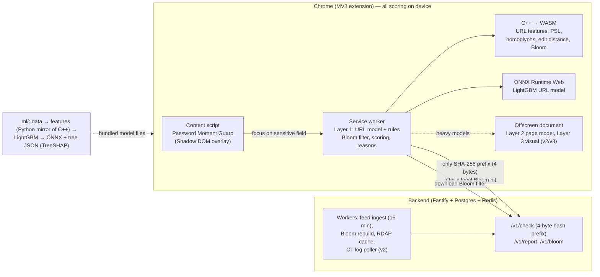

# PhishGuard AI

**Warns you at the exact moment you type a password or card number on a phishing site, explains why in plain language, and aims to catch brand-new phishing domains before public blocklists do.**


## The problem

Blocklists are slow: a phishing domain usually lives for hours, and many are dead before they appear on a public list. Browser warnings that fire on every page get ignored. PhishGuard stays quiet while you browse and speaks up only at the risky moment — focus on a password, card or OTP field — with a short, specific explanation such as:

- *Contains "examplebank" but is not examplebank.test*
- *Uses look-alike characters to imitate ExampleBank (examplebank.test)*
- *Domain registered 3 days ago*

## Architecture



More detail: [architecture](docs/architecture.md), [privacy](docs/privacy.md), [permissions](docs/permissions.md), [enterprise install](docs/enterprise.md), [interview notes](docs/interview_notes.md).

## Results

Every number below is generated by `python scripts/update_readme_results.py` from `ml/results/*.json`, which the scripts in `ml/scripts/` write. Nothing is typed by hand.

<!-- RESULTS:START -->
> ⚠️ **Synthetic sample data.** These numbers come from `ml/scripts/make_sample_data.py` (template-generated URLs) and only prove the pipeline runs end to end. They say **nothing** about real-world accuracy. Re-run with real data (docs/HUMAN_TODO.md) before quoting any number.

| Model | PR-AUC | Recall @ 0.1% FPR | Precision (score > 60) | Recall (score > 60) |
|---|---|---|---|---|
| Rules-only baseline | 0.970 | 68.9% (≤3 FP of 3056) | 100.0% | 50.1% |
| Layer 1 URL model (ONNX) | 1.000 | 99.6% (≤3 FP of 3056) | 100.0% | 99.4% |
| Shipped score (model + hard rules) | 1.000 | 99.6% (≤3 FP of 3056) | 100.0% | 99.4% |

Test split: 6327 URLs (3271 phishing), 2142 registered domains, first seen 2026-05-17 → 2026-09-30; no domain overlaps with training. Source: `ml/results/url_eval.json` (commit 08ba433-dirty).
URL model size: ONNX 585 KB, 263 trees; ONNX vs LightGBM max |Δp| = 1.4e-04. Source: `ml/results/url_train.json`.
Feature parity (Python vs native C++ vs WASM): 1000 URLs × 26 features, **0 mismatches**. Source: `ml/results/parity.json`.
Layer 2 page model: PR-AUC 1.000, recall@0.1%FPR 99.3% (≤0 FP of 401) on 1001 synthetic-sample pages. Source: `ml/results/page_eval.json`.
Lead time vs public feeds: median 3.0 h ahead of the earliest public feed (p25 0.6 h, p90 11.7 h); 77% of 354 domains seen before any feed (synthetic-sample). Source: `ml/results/leadtime.json`.
Layer 3 visual model: int8 model 887 KB (fp32 2390 KB), CPU latency p50 1.1 ms; test clone detection 55.6% at 1.6% false matches on generic pages (rule 'proto', fictional-brand synthetic data). Source: `ml/results/visual_eval.json`.
Robustness (scripted attacks): worst attack for the shipped score: evasion_clean (recall at score > 60 99.4% → 93.6%) on 3252 synthetic-sample phishing URLs; full table in the JSON. Source: `ml/results/robustness.json`.
Score drift: score PSI 0.027 (stable) between the training window (20545 URLs) and the newest 30 days (2874 URLs); most drifted feature: host_entropy (PSI 0.043). Source: `ml/results/drift.json`.
Real-website false warnings (launch gate): 9 of 102 hand-picked real legitimate URLs would show a warning (8.8%; launch gate is ≤ 1%) — FAIL: do not publish this model. Source: `ml/results/real_sites.json`.
<!-- RESULTS:END -->

## Repository layout

| Path | What |
|---|---|
| `extension/` | MV3 extension (TypeScript, Vite): service worker, content script, popup, block page, offscreen document |
| `wasm/` | C++17 feature extractor → WebAssembly; GoogleTest unit tests |
| `ml/` | Python: data scripts, features (bit-exact mirror of the C++), training, evaluation, ONNX export |
| `backend/` | Fastify API + workers (feeds, Bloom, RDAP, CT logs), Postgres, Redis |
| `dashboard/` | Teams admin dashboard (served by the backend at `/dashboard/`) |
| `shared/` | Data shared by every component: brands, PSL, confusables, tokens, feature spec, shared TS loader |
| `docs/` | Architecture, privacy, permissions, licences, interview notes, HUMAN_TODO, store listing |

## How to run everything

**New here? Read [docs/RUNNING.md](docs/RUNNING.md)** — VS Code setup, trying it in Chrome, the test lab, and the steps to publish.


Prerequisites: Node 20+, Python 3.11+, CMake 3.16+, a C++17 compiler, and **either** Emscripten (`emsdk`) **or** `pip install ziglang` for the WASM build.

```bash
pip install lightgbm onnx onnxruntime onnxmltools skl2onnx numpy pandas scikit-learn pytest
(cd extension && npm install) && (cd backend && npm install)

make wasm            # native build, C++ unit tests, WASM (zig). With emsdk: make wasm-emscripten
make data train eval # synthetic sample data → LightGBM → ONNX → ml/results/url_eval.json
make bloom parity    # Bloom filter + Python/C++/WASM parity on 1,000 URLs
make ext             # builds extension/dist  → chrome://extensions → "Load unpacked" → extension/dist
make test            # pytest, vitest, backend tests, Playwright e2e, lint
make readme          # refresh the results table above
```

Real data instead of the synthetic sample:

```bash
python ml/scripts/download_tranco.py --top 100000
python ml/scripts/download_openphish.py          # check licence first: docs/data_licenses.md
PHISHTANK_APP_KEY=... python ml/scripts/download_phishtank.py
python ml/scripts/clean_dedupe.py
python ml/scripts/train_url.py --host-only && python ml/scripts/eval_url.py --host-only   # see "leakage" in docs/interview_notes.md
```

Teams dashboard (demo data):

```bash
make dashboard
DATABASE_URL=postgres://… npm --prefix backend run seed:demo    # prints a demo dashboard token
# open http://localhost:8787/dashboard/ and paste the token. Managed install: docs/enterprise.md
```

Backend:

```bash
cp .env.example .env && docker compose up --build      # API on :8787, workers, Postgres, Redis
# extension pointing at it:
VITE_API_BASE=http://localhost:8787 make ext
```

## Status

See [PLAN.md](PLAN.md) for the phase checklist and [docs/HUMAN_TODO.md](docs/HUMAN_TODO.md) for everything that needs your accounts, keys or decisions.
