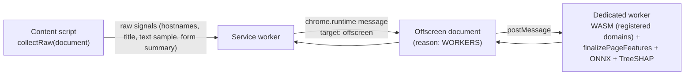
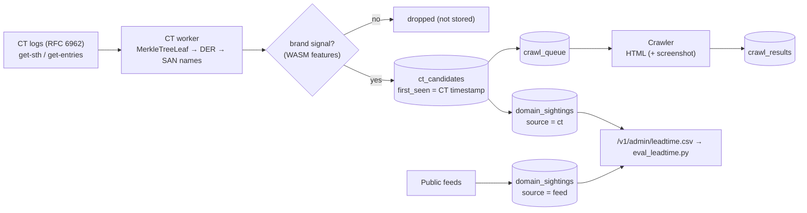

# Architecture

## 1. Request flow at the "password moment"

```mermaid
sequenceDiagram
  participant U as User
  participant CS as Content script (page)
  participant SW as Service worker
  participant W as WASM extractor
  participant M as ONNX Runtime Web
  participant B as Backend /v1/check
  U->>CS: focuses / types in password field
  CS->>SW: getVerdict(url, page signals)
  SW->>W: extract(url) → 26 features + brand match details
  SW->>W: bloomContains(registered domain)?
  alt Bloom hit
    SW->>B: 4-byte SHA-256 prefix
    B-->>SW: all full hashes with that prefix
    SW->>SW: compare full hash locally → confirmed / not
  end
  SW->>M: URL model probability
  SW->>SW: TreeSHAP → top-3 reasons; rules, trusted list, seen-before → score
  SW-->>CS: Verdict {score, band, reasons}
  alt score > 30
    CS->>U: Shadow-DOM overlay (accessible dialog)
  end
```

Navigation itself is also scored (silently, toolbar badge only). A **confirmed** known-bad site is replaced by the block page before the user can type anything.

## 2. Components

| Component | Runs in | Responsibility |
|---|---|---|
| `wasm/` C++17 | WASM in SW + backend; native for tests | URL normalisation and parsing, Public Suffix List, 26 URL features, homoglyph skeleton, punycode + mixed-script detection, banded edit distance, Bloom filter |
| `shared/ts/wasm-loader.ts` | SW, backend, Node tests | Loads the WASI-reactor module with a 40-line shim; same code everywhere |
| `extension/src/lib/engine.ts` | Service worker | Layer 1 verdict: features → ONNX → rules → known-bad → user context → reasons |
| `extension/src/lib/treeshap.ts` | Service worker | Exact TreeSHAP over the LightGBM trees for explanations |
| `extension/src/content/*` | Every frame | Detect sensitive fields, show the overlay, collect page signals |
| `extension/src/offscreen/*` | Offscreen document (v2+) | Layer 2 page model and Layer 3 visual model (heavy, long-lived) |
| `backend/src/api` | Fastify | `/v1/check`, `/v1/report`, `/v1/bloom` (+ license, teams, feed API in v3/v4) |
| `backend/src/workers` | Worker process | Feed ingest every 15 min, Bloom rebuild, RDAP cache, CT log poller (v2) |
| `ml/` | Offline | Data, features (bit-exact Python mirror of the C++), LightGBM, ONNX, evaluation |

## 3. Why the C++ extractor exists (and how parity is guaranteed)

Training (Python) and inference (browser) must compute *exactly* the same features, or the model silently degrades ("training/serving skew"). We write the extractor once in C++, compile it to WASM for the browser and the backend, and keep a line-by-line Python mirror for training. `ml/scripts/parity_test.py` runs Python, native C++ and the WASM build on 1,000 URLs (including 58 adversarial edge cases) and compares the **IEEE-754 bit patterns** of all 26 features — any difference fails the build.

Floating-point features (entropy) use a deterministic `log2` built only from `frexp`, `+ − × ÷` (decision D3), and the C++ is compiled with `-ffp-contract=off` so no fused multiply-add changes rounding.

## 4. Scoring

```
if confirmed known-bad            → 100 (block page)
base   = 100 × max(P_url, P_page, P_visual)      (rules score if no model loaded)
score  = max(base, hard-rule floors)              e.g. Unicode look-alike of a brand → ≥ 75
if Bloom hit but offline          → score ≥ 80   (D7: a Bloom filter can be wrong)
if visited before without warning → score − 25
if on the user's trusted list     → score ≤ 5
bands: 0–30 safe · 31–60 caution · 61+ warning;  overlay only if score > 30
```

Reasons: TreeSHAP values (log-odds contributions) are ranked; each feature has a template that **also checks the feature value**, so a reason is shown only if it is literally true for this URL. Related features (brand-in-host / homoglyph / edit distance) are grouped so the same evidence is never shown twice.

## 5. Service-worker lifecycle (MV3)

Chrome may stop the service worker at any time. Therefore:
- every durable value (settings, trusted list, hashed "seen" set, downloaded Bloom filter) lives in `chrome.storage.local`;
- per-tab verdicts and one-time "proceed anyway" allowances live in `chrome.storage.session`;
- the `Engine` (WASM + ONNX session) is a cache, rebuilt lazily on the next event;
- periodic work uses `chrome.alarms`, not `setInterval`.

## 6. Build and packaging

- Vite builds the service worker as an ES module and the content script separately as a classic IIFE (content scripts cannot be modules).
- ONNX Runtime Web is imported through its "wasm bundle" entry, whose JS glue is bundled statically (MV3 service workers forbid dynamic `import()`); the ORT `.wasm` is shipped in `/ort/`.
- No code is loaded from the network at runtime. Model weights and data files ship inside the package.

## 7. Backend data model (v1)

`known_bad_domains` (registered domain, full hash, 4-byte prefix, first/last seen, sources), `domain_sightings` (first time each source reported a domain — used for lead-time), `reports` (review queue; registered domain only), `rdap_cache`, `bloom_versions`. **No table stores URLs, IP addresses or browsing history.**

## 8. Phase v2 additions

### Layer 2 — page model (offscreen document)



- Runs only at the password moment (a sensitive field is focused), never on plain browsing.
- **One implementation of page features** (`extension/src/lib/pagefeatures.ts`): `collectRaw` uses only DOM APIs that jsdom also supports, so training (`extension/scripts/page_features.ts` on jsdom) and inference use the same code — no Python mirror, no skew.
- Why our own worker and not ONNX Runtime's `proxy` option: ORT's proxy re-loads *its own script URL* as the worker, which after bundling is our offscreen page script (that calls `chrome.*`, unavailable in workers).
- Combination: `P = max(P_url, P_page)`, plus page hard-rule floors (password form posting to an unrelated domain while the title claims a brand → ≥ 70).
- Reasons from both layers are merged by weight (both are SHAP log-odds). "Hard evidence" (form posts your password elsewhere; mailto/IP action) is pinned first.

### Certificate Transparency discovery



- Pre-certificate entries contain only the TBSCertificate, which `node:crypto` cannot parse, so `backend/src/lib/der.ts` is a ~100-line bounds-checked DER reader (fuzzed with random bytes in tests).
- Only domains with a brand signal are stored (privacy + volume: CT logs carry millions of certificates per day).
- `crawl_queue` uses `FOR UPDATE SKIP LOCKED` so several crawler replicas never take the same job.

### Review queue → retraining

`Report mistake` → `/v1/report` (pending) → admin review (`/v1/admin/reports/:id/review`, bearer `ADMIN_TOKEN`) → `/v1/admin/reports/export` → `ml/scripts/import_reviews.py` → `train_url.py --extra`. Regional labels follow the same path via `label_cli.py export`.
